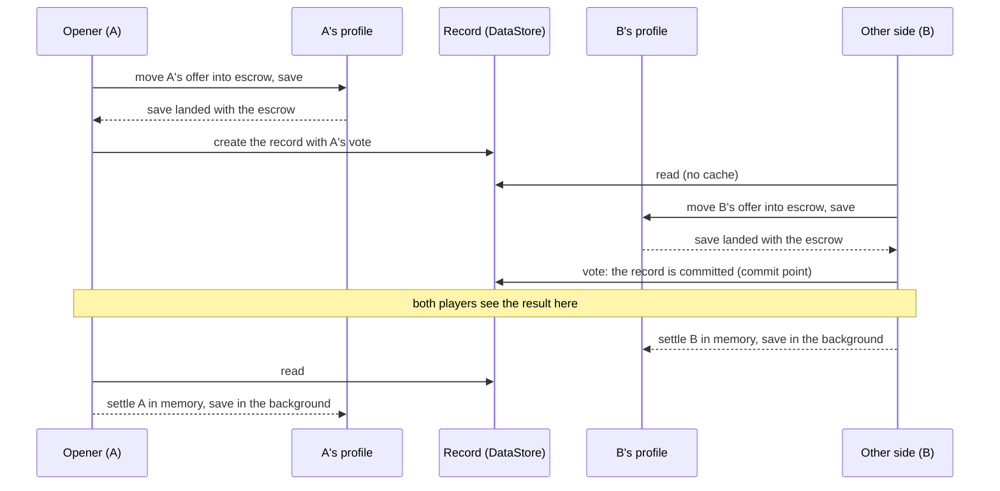
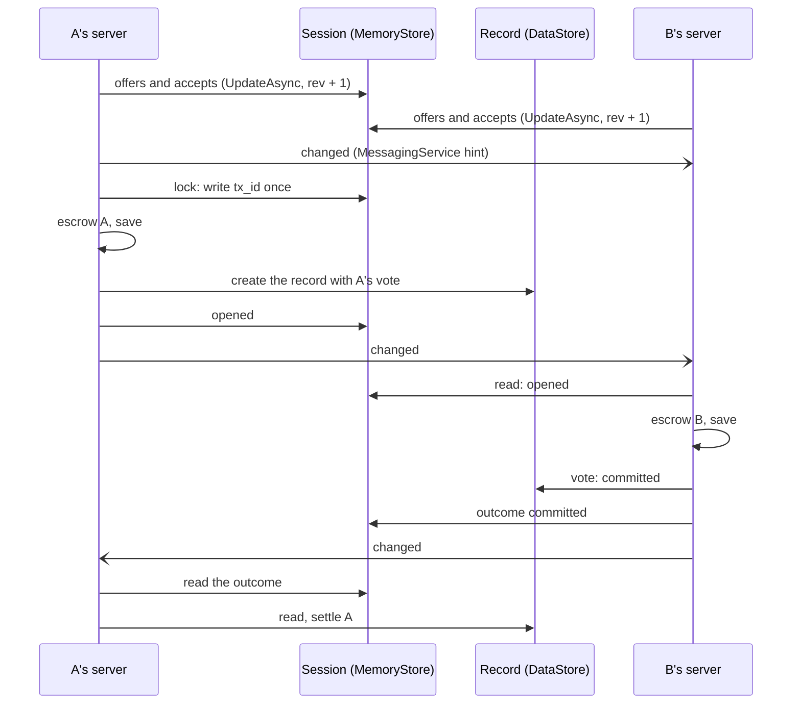

# Trade protocol

Two profiles and one record. Each side moves its offer into an escrow inside its own profile, and
the record decides what happens to both escrows. The guarantees are in
[invariants.md](invariants.md); this page shows the order of the writes and what every failure
leaves behind.

## Same server

## Across servers

The same writes, with a shared session on MemoryStore that decides when the record starts and lets
each server see the other's progress ([decision 0003](0003-cross-server-trades-and-gifts.md)).

## What every failure leaves behind

| Failure | Durable at that moment | What happens next |
|---|---|---|
| A's server crashes before its escrow save lands | Nothing | A reloads its old inventory. No record exists. Across servers, B aborts after 25 s of silence and writes a tombstone. |
| A's escrow is saved, the record create fails | A's escrow | A's recovery finds no record and, after `missing_record_grace` (60 s), writes an aborted tombstone and refunds A. |
| The create landed but reported an error | A's escrow and the open record | Either side finishes from the record (`trade_protocol.spec`). |
| B's server crashes before its escrow save lands | A's escrow and the open record | After `record_timeout` (120 s), A's recovery aborts the record and refunds A. B reloads untouched. |
| B's escrow is saved, its vote fails | Both escrows and the open record | B's recovery sees its escrow and votes again, or the record times out and both are refunded. |
| B's vote lands | Committed record and both escrows | This is the commit point. Nothing can abort the record any more. |
| A crash after the commit, before a settlement is saved | Committed record and the escrow still in the saved profile | Recovery on the next load or sweep settles from the record. Settling twice changes nothing. |
| A settlement save in the background never lands | Same as above | Same as above. The chaos simulation drops 20% of these saves on purpose. |
| An offered item is spent or traded away during negotiation | Nothing new | B's hold fails, B aborts the record, A is refunded. |
| The MemoryStore session expires or is lost | Profiles and record | Escrows are settled from the record by recovery. The players see the trade as expired or pending. |
| A MessagingService hint is lost | Nothing new | The other server sees the change at its next poll, 2 s later. |
| The server running the trade loses the profile session | The profile on the new server | The old server cannot save any more (ProfileStore rejects it), and recovery on the new server settles the escrow. |
